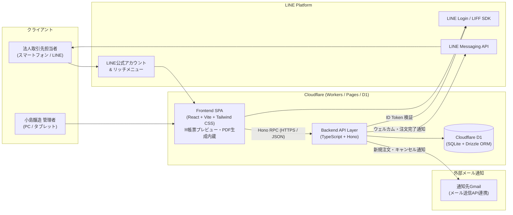
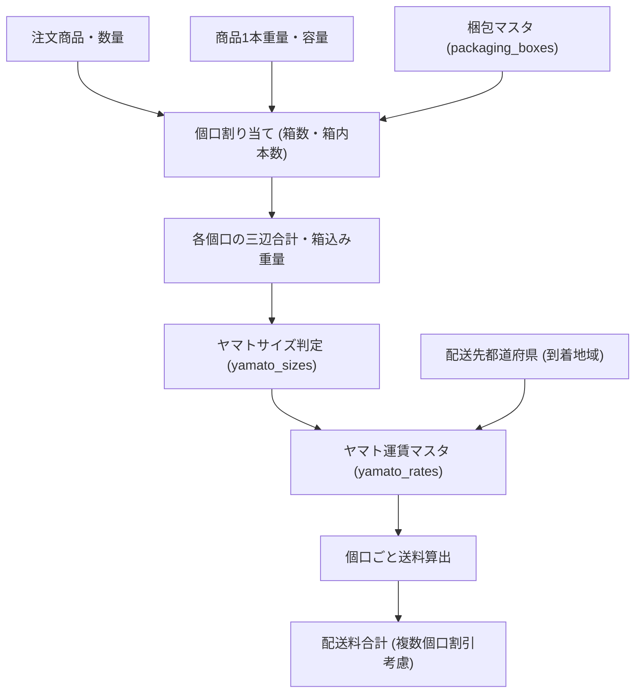

# システム設計書

作成日: 2026-10-19  
版: 2.0（TypeScript + Hono + Cloudflare D1 対応版）

## 1. システム目的

小島醸造の法人取引先向け受注業務をLINE中心に電子化する。

- **顧客側（法人取引先）**: LINE公式アカウントのリッチメニューからLIFFアプリを起動し、自社専用の販売単価での商品注文・到着希望日指定・注文履歴確認・注文編集・キャンセルをLINE上だけで完結させる。
- **管理者側（小島醸造）**: PC・タブレット対応の管理ポータルから、取引先・配送先・招待QRコード・商品・取引先別販売単価・注文・配送カレンダー・梱包・送料・請求・帳票プレビュー＆PDF出力・システム設定を一元管理する。

---

## 2. 全体アーキテクチャ構成

### 2.1 システム構成図



### 2.2 採用技術スタック

| 区分 | 技術要素 | 用途・備考 |
|---|---|---|
| **Runtime / Hosting** | Cloudflare Workers / Pages | エッジでの高速配信、サーバーレス運用、無料枠内で十分な稼働が可能 |
| **Backend Framework** | **TypeScript + Hono** | ルーティング、認証ミドルウェア、Zodによる入力検証、Hono RPCによる型公開 |
| **Database / ORM** | **Cloudflare D1** + **Drizzle ORM** | SQLiteベースのマネージドRDB。トランザクション・外部キー制約・履歴保持を安全に実行 |
| **Frontend** | **React + Vite + Tailwind CSS** | 顧客向けLIFF画面（モバイル最適化）＋ 管理者ポータル画面（高齢者配慮UI） |
| **PDF / 帳票出力** | **HTML/CSS A4プレビュー + PDF出力** | R2等の有料ストレージを使わず、D1内のスナップショットJSONからA4プレビューを描画し、PDFダウンロード・印刷を実行 |
| **LINE連携** | LIFF SDK / LINE Login / Messaging API | ID Token検証による本人確認、友だち追加連動、注文完了プッシュメッセージ |

---

## 3. レイヤ構成

### 3.1 プレゼンテーション層
- **LINE公式アカウント リッチメニュー**: 注文、注文履歴、お問い合わせ、商品紹介の4導線
- **LIFF 顧客Webアプリ**: 招待登録、注文、カート、履歴、注文編集、商品紹介、お問い合わせ（全18画面）
- **管理者ポータル Webアプリ**: ダッシュボード、注文管理、取引先・QR招待管理、取引先別単価管理、商品管理、配送・梱包・運賃管理、請求管理、帳票プレビュー・PDF出力、監査ログ、各種設定（全25画面）

### 3.2 アプリケーション層（Hono API）
- **認証・認可ミドルウェア**:
  - 顧客API: LIFFの `ID Token` を検証して `lineUserId` を抽出し、紐づく有効な `company_id`（取引先ID）を特定する。
  - 管理者API: 管理者セッション（JWT / HttpOnly Cookie）を検証し、操作者 `admin_id` を特定する。
- **ドメインサービス**:
  - 招待QRコード発行・検証・LINE紐付けサービス
  - 商品・取引先別販売単価取得サービス
  - 配送先・配送ルール・到着希望日カレンダー算出サービス
  - 自動梱包（箱割り当て）・ヤマトサイズ判定・複数個口送料計算サービス
  - 税計算・端数処理サービス
  - 注文確定（冪等性検証）・注文直接編集（排他ロック・単価維持）・キャンセルサービス
  - 請求書集計・発行・請求ロック・取消・再発行サービス
  - 帳票データ（納品書・請求書・QR案内状）スナップショット生成サービス
  - メール通知・LINE Messaging API通知サービス
  - 監査ログ記録サービス

### 3.3 データ層（Cloudflare D1）
- 全25テーブルによるマスタ・トランザクション・履歴・スナップショット・監査ログの永続化。
- 帳票発行履歴（`invoice_histories`）には発行時点の全印字項目を `snapshot_json` として保存し、外部ストレージ（R2等）なしで過去版の完全再現とPDF再ダウンロードを保証する。

---

## 4. 初回登録・QRコード認証設計（企業単位・複数人読み取り対応）

管理者が取引先を選択して、企業IDに紐づく招待QRコード（および招待URL）を発行する。同一企業の複数担当者（店長、発注係など）が同じQRコードを読み取って登録できる。

```text
管理ポータル (A-08)
→ 取引先を選択して招待QRコード発行（有効期限・上限人数を設定、案内状PDF印刷可）
→ 取引先へQRコード案内状を送付・手渡し
→ 取引先スタッフがスマホでQRコード読み取り
→ LIFF起動 & LINE Login（友だち追加オプションにより公式アカウントも同時追加）
→ 招待トークン検証（有効期限内 かつ 登録人数 < 上限人数）
→ 招待登録画面 (L-01) で取引先名を確認し、「担当者名」を入力して登録
→ D1の line_users テーブルに (lineUserId ↔ company_id) を保存 & 登録人数カウント +1
→ LINE Messaging API でトーク画面にウェルカムメッセージを送信
→ 以後、リッチメニューから注文画面を開くと自動で取引先を識別
```

- 招待トークンはSHA-256ハッシュ値のみをD1へ保存する。
- 1つの招待QRコードにつき、最大登録人数（`max_uses`、例：5名または無制限）と有効期限（`expires_at`、例：30日間）を設定でき、管理画面からいつでも即時無効化・再発行が可能。
- すでに別企業へ紐付いている `lineUserId` が他社のQRコードを読み取った場合は、上書きせずエラー画面（`L-18`）を表示する。

---

## 5. 価格モデル（企業別販売単価と初回注文単価維持）

### 5.1 商品マスタと取引先別販売単価
- **標準卸価格**: `products`（商品マスタ）に税抜の標準卸価格を保持する。
- **取引先別販売単価**: `company_product_prices` テーブルに `取引先ID × 商品ID` ごとの販売単価（税抜）を保持する。
  - 取引先別単価が設定されている場合はその単価を優先適用し、未設定の場合は商品マスタの標準卸価格を適用する。
  - `業者限定 (is_limited = 1)` の商品は、取引先別販売単価で取扱許可（`is_available = 1`）が設定されている取引先にのみ表示する。
  - 注文数量に応じた自動割引（ボリュームディスカウント）は行わない。

### 5.2 同一注文内での初回注文時単価維持
確定済み注文を後から編集（数量変更）する場合、**同一注文内では初回注文時の単価をそのまま維持**する。

```text
例:
1. 初回注文時: 犬山忍冬酒 300ml を 10本 × 2,100円 で注文確定
2. その後、マスタ上の単価が 2,200円 へ改定される
3. 到着3営業日前までに注文編集で数量を 10本 → 15本 に変更
→ 結果: 15本 × 2,100円（初回注文時の単価を維持）
※注文編集時に「初回注文に含まれていなかった別商品」を新規追加した場合のみ、追加時点の現在単価を適用する。
```

この仕様により、複雑な価格ロット分割を排除し、注文明細・納品書・請求書の1商品1行表示と計算の明快さを保つ。

---

## 6. 配送先・配送方式・到着希望日

### 6.1 配送先マスタ
- 1つの取引先に複数の配送先（本店、支店、倉庫など）を登録可能とする。
- 顧客は注文時に登録済み配送先から選択する。
- 注文確定時には選択された配送先情報（名称・郵便番号・住所・電話番号）を注文テーブルへスナップショット保存する。

### 6.2 配送方式と送料
- **近隣配達（自社便）**: 指定地域（犬山市・小牧市・丹羽郡・江南市・各務原市・可児市：月2回期間）および45km圏内（月1回期間）は自社配達とし、**配送料は無料（0円）**とする。
- **宅急便配送（ヤマト運輸固定）**: 近隣配達対象外はヤマト運輸の宅急便を使用し、梱包計算に基づく配送料を加算する。

### 6.3 到着希望日
- 顧客が指定する日付名称は `到着希望日` とする。
- `最短リードタイム（注文日からN営業日後）` × `配送先の配送ルール期間` × `配送カレンダーの配送可能日` のすべてを満たす日付のみ選択可能とする。

---

## 7. 梱包・ヤマト送料計算



- 梱包条件・サイズ上限・地域別運賃はすべてD1マスタテーブルで管理し、ソースコードへハードコードしない。
- 管理者は注文編集画面（`A-04`）で自動計算された送料を手動で上書き調整することも可能とする。

---

## 8. 注文ステータスと編集・ロック制御

### 8.1 注文ステータス定義（全6種）

| ステータスコード | 表示名 | 顧客による注文編集 | 顧客によるキャンセル | 備考 |
|---|---|:---:|:---:|---|
| `received` | 受付済 | ○ | ○ | 新規注文直後の初期状態 |
| `confirmed` | 確認済 | ○ | ○ | 小島醸造側で内容確認済み |
| `preparing` | 配送準備中 | × | × | 梱包・出荷手配開始後 |
| `shipped` | 発送済 | × | × | 出荷・配達出発済み |
| `completed` | 完了 | × | × | 納品完了 |
| `cancelled` | キャンセル済 | × | × | キャンセル確定（論理保持） |

### 8.2 顧客による編集・キャンセル可能条件

```text
ステータスが「受付済 (received)」または「確認済 (confirmed)」
AND 現在日時 ≦ 到着希望日の3営業日前 17:00
AND 請求ロックなし (is_invoice_locked = 0)
AND 他者による注文編集ロック中でないこと
```

### 8.3 注文編集ロック（排他制御・楽観ロック）
- 編集画面（`L-11` / `A-04`）を開いた時点で10分間の編集ロックを取得する（操作継続中は延長）。
- ロック保持者以外が開いた場合は「現在別の利用者が編集中です」と表示し閲覧のみとする。
- 保存時には `version` カラムによる楽観ロック検証も併用し、競合による先祖返りを防止する。
- 管理者はロックを強制解除可能。

### 8.4 二重注文防止（冪等性保証）
- 注文確認画面（`L-07`）表示時に一意の `request_id`（UUID）を発行する。
- Hono APIで `order_requests` テーブルおよび `orders.request_id` のユニーク制約により検証し、通信リトライや連打による同一 `request_id` の再送時は新規作成せず既存注文結果を返す。

---

## 9. 請求ロックと帳票プレビュー・PDF出力

### 9.1 請求ロック
- 請求書が発行された注文は `is_invoice_locked = 1` となり、管理者であっても直接編集・キャンセル不可となる。
- 修正が必要な場合は `請求取消 → 取消履歴保存 → 注文ロック解除 → 注文修正 → 請求書再発行（v2）` の手順を踏む。

### 9.2 帳票プレビュー＆PDFダウンロード（R2不使用）
- 納品書、御請求書、QR招待案内状は、管理画面の帳票プレビュー画面（`A-24`）でA4印刷レイアウトのまま確認でき、ブラウザ上で直接PDFダウンロードまたは印刷を行える。
- 請求書の発行履歴（v1, v2...）は発行時点の全印字項目を `invoice_histories.snapshot_json` に保存するため、後日会社情報やマスタが変更されても、発行当時の内容でいつでもプレビュー・PDF再出力が可能である。

---

## 10. 監査ログと酒税の分離

- **監査ログ**: マスタ変更、単価変更、注文作成・編集・キャンセル・ステータス変更、請求発行・取消、QR招待発行・解除などの主要操作は、D1のトランザクション（`db.batch()`）内で業務データ更新と同時に `audit_logs` テーブルへ記録する。
- **酒税の分離**: 受注システムでは酒税を注文時の別明細として加算しない（販売単価に含めて税抜管理）。酒税帳簿・酒税申告・移出数量管理は本システムのMVP対象外とする。
