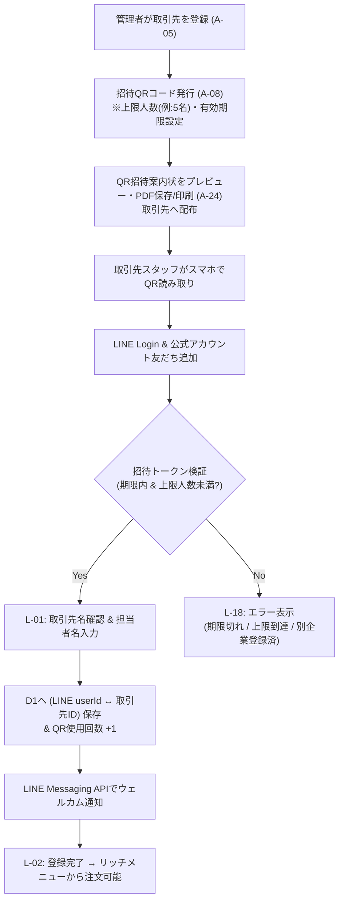
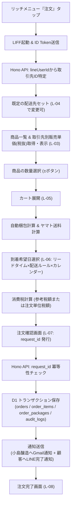
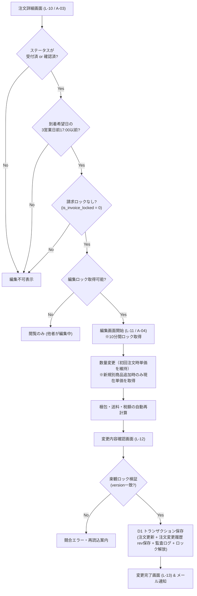
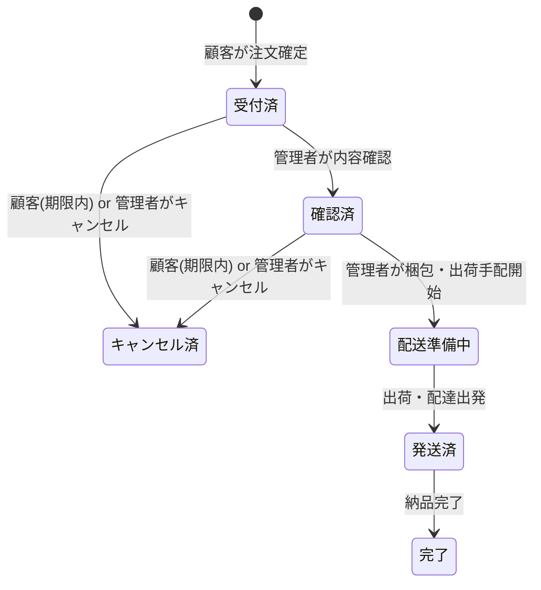
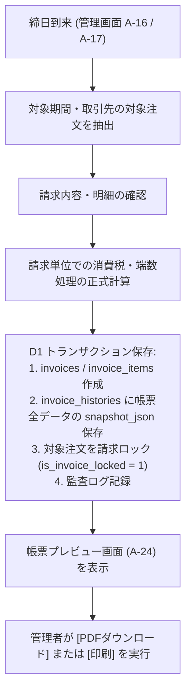
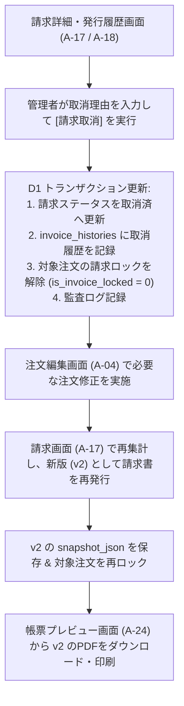

# 業務フロー設計書

作成日: 2026-10-19  
版: 2.0（TypeScript + Hono + Cloudflare D1 対応版）

## 1. 初回登録・QRコード紐付けフロー（企業単位・複数人対応）

1つの取引先企業に対して発行したQRコードを、その企業の複数スタッフ（店長、発注担当者A・Bなど）が読み取って登録できるフロー。

---

## 2. 通常注文フロー

2回目以降はLINE公式アカウントのリッチメニュー「注文」をタップするだけで、自動的に取引先と企業別販売単価が識別される。

---

## 3. 注文編集フロー（初回注文時単価の維持）

確定済み注文の直接編集フロー。**同一注文内の既存商品は初回注文時の単価を維持**し、新規追加した別商品のみ編集時点の取引先別販売単価を適用する。

---

## 4. 注文ステータス遷移フロー

- 顧客がLINEから編集・キャンセルできるのは **`受付済` または `確認済`**（かつ到着希望日の3営業日前17:00以前・請求ロックなし）のみ。

---

## 5. 請求書発行・プレビュー・PDF出力フロー（R2不使用）

---

## 6. 請求取消・注文修正・請求書再発行フロー

請求書発行後に対象注文の修正が必要になった場合の業務フロー。

※過去に取り消した `v1` の請求書も、`invoice_histories` の `snapshot_json` からいつでも当時の内容でプレビュー確認が可能。
