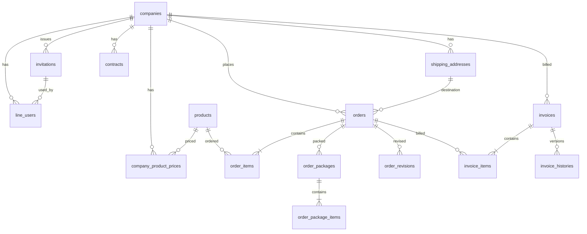

# DB設計書（Cloudflare D1 / SQLite）

作成日: 2026-10-19  
版: 2.0（TypeScript + Hono + Cloudflare D1 対応版）

## 1. 基本方針

- **Cloudflare D1（SQLite）** をデータストアとして使用し、**Drizzle ORM** でスキーマおよびマイグレーションを管理する。
- 主キー（PK）・外部キー制約（FK）・ユニーク制約をRDBレベルで定義し、データの整合性を保証する。
- 価格改定・注文変更・請求書再発行など履歴が必要なデータは上書きせず履歴テーブルおよびスナップショットカラムで保持する。
- 帳票（納品書・請求書）はCloudflare R2等の外部有料ストレージを使用せず、発行時点の全印字データをJSONスナップショットとしてD1内に保存し、画面プレビューおよびオンデマンドPDFダウンロードを行う。
- 同一注文内の編集では初回注文時の単価を維持するため、旧設計の `注文価格ロット` テーブルを廃止し、`order_items`（注文明細）に `unit_price`（注文時単価）を直接保持する。

---

## 2. テーブル一覧（全26テーブル）

### マスタ系（16テーブル）
1. `admins`（管理者）
2. `companies`（取引先 / 顧客）
3. `shipping_addresses`（配送先）
4. `invitations`（QR招待管理）
5. `line_users`（LINE利用者紐付け）
6. `contracts`（契約・請求条件）
7. `products`（商品）
8. `company_product_prices`（取引先別販売単価）
9. `shipping_rules`（配送ルール）
10. `delivery_calendar`（配送カレンダー）
11. `packaging_boxes`（梱包箱）
12. `yamato_sizes`（ヤマトサイズ）
13. `yamato_rates`（ヤマト運賃）
14. `company_info`（小島醸造 会社情報・銀行口座）
15. `settings`（システム設定）
16. `report_settings`（帳票設定）

### トランザクション・履歴系（10テーブル）
17. `orders`（注文）
18. `order_items`（注文明細）
19. `order_packages`（注文梱包結果）
20. `order_package_items`（注文梱包明細）
21. `order_revisions`（注文変更履歴）
22. `order_requests`（注文リクエスト / 二重注文防止）
23. `invoices`（請求）
24. `invoice_items`（請求明細）
25. `invoice_histories`（請求書発行履歴・スナップショット）
26. `audit_logs`（監査ログ）

---

## 3. ER図

---

## 4. 各テーブル詳細定義

### 4.1 `admins`（管理者）
| カラム名 | 論理名 | 型 | 制約・説明 |
|---|---|---|---|
| `id` | 管理者ID | TEXT | PK |
| `login_id` | ログインID | TEXT | UNIQUE, NOT NULL |
| `password_hash` | パスワードハッシュ | TEXT | NOT NULL |
| `name` | 管理者氏名 | TEXT | NOT NULL（監査ログ・請求書発行者記録用） |
| `role` | 権限ロール | TEXT | `owner` / `staff` |
| `status` | 状態 | TEXT | `active` / `inactive` |
| `created_at` | 登録日時 | TEXT | ISO8601 |

### 4.2 `companies`（取引先 / 顧客）
| カラム名 | 論理名 | 型 | 制約・説明 |
|---|---|---|---|
| `id` | 取引先ID | TEXT | PK |
| `name` | 会社名・屋号 | TEXT | NOT NULL |
| `contact_name` | 担当窓口名 | TEXT | |
| `phone` | 電話番号 | TEXT | |
| `postal_code` | 郵便番号 | TEXT | |
| `address` | 住所 | TEXT | |
| `status` | 状態 | TEXT | `active` (有効) / `inactive` (無効) |
| `note` | 備考 | TEXT | |
| `created_at` | 作成日時 | TEXT | ISO8601 |
| `updated_at` | 更新日時 | TEXT | ISO8601 |

### 4.3 `shipping_addresses`（配送先）
| カラム名 | 論理名 | 型 | 制約・説明 |
|---|---|---|---|
| `id` | 配送先ID | TEXT | PK |
| `company_id` | 取引先ID | TEXT | FK (`companies.id`), NOT NULL |
| `name` | 配送先名 | TEXT | NOT NULL（例：「本店」「第2倉庫」） |
| `postal_code` | 郵便番号 | TEXT | NOT NULL |
| `prefecture` | 都道府県 | TEXT | NOT NULL（ヤマト運賃の地域判定に使用） |
| `city` | 市区町村 | TEXT | NOT NULL（近隣配達ルール判定に使用） |
| `address_line1` | 住所（番地） | TEXT | NOT NULL |
| `address_line2` | 建物名・部屋番号 | TEXT | |
| `phone` | 電話番号 | TEXT | NOT NULL |
| `contact_name` | 配送先担当者名 | TEXT | |
| `is_default` | 既定配送先フラグ | INTEGER | Boolean (0 or 1) |
| `shipping_rule_id` | 配送ルールID | TEXT | FK (`shipping_rules.id`) |
| `status` | 状態 | TEXT | `active` / `inactive` |
| `note` | 備考 | TEXT | |

### 4.4 `invitations`（QR招待管理 — 企業単位・複数人読み取り対応）
| カラム名 | 論理名 | 型 | 制約・説明 |
|---|---|---|---|
| `id` | 招待ID | TEXT | PK |
| `company_id` | 取引先ID | TEXT | FK (`companies.id`), NOT NULL |
| `token_hash` | 招待トークンハッシュ | TEXT | UNIQUE, NOT NULL（SHA-256） |
| `max_uses` | 最大登録可能人数 | INTEGER | 例: `5`（NULLの場合は人数無制限） |
| `used_count` | 現在登録済み人数 | INTEGER | DEFAULT 0, NOT NULL |
| `expires_at` | 有効期限 | TEXT | ISO8601 |
| `status` | 状態 | TEXT | `active` (有効) / `revoked` (無効化) / `expired` (期限切れ) |
| `created_by` | 発行管理者ID | TEXT | FK (`admins.id`) |
| `created_at` | 発行日時 | TEXT | ISO8601 |
| `note` | 備考 | TEXT | |

### 4.5 `line_users`（LINE利用者紐付け）
| カラム名 | 論理名 | 型 | 制約・説明 |
|---|---|---|---|
| `id` | 紐付けID | TEXT | PK |
| `company_id` | 取引先ID | TEXT | FK (`companies.id`), NOT NULL |
| `line_user_id` | LINEユーザーID | TEXT | UNIQUE, NOT NULL（1 LINEユーザーは1企業に一意紐付け） |
| `staff_name` | 担当者名 | TEXT | NOT NULL（`L-01` 招待登録画面で入力された氏名） |
| `line_display_name` | LINE表示名 | TEXT | 登録時のLINEプロフィール表示名（参考記録用） |
| `invitation_id` | 使用した招待ID | TEXT | FK (`invitations.id`) |
| `registered_at` | 登録日時 | TEXT | ISO8601 |
| `status` | 状態 | TEXT | `active` (有効) / `unlinked` (解除済) |
| `note` | 備考 | TEXT | |

### 4.6 `contracts`（契約・請求条件）
| カラム名 | 論理名 | 型 | 制約・説明 |
|---|---|---|---|
| `id` | 契約ID | TEXT | PK |
| `company_id` | 取引先ID | TEXT | FK (`companies.id`), NOT NULL |
| `contract_name` | 契約名 | TEXT | NOT NULL |
| `start_date` | 開始日 | TEXT | YYYY-MM-DD |
| `end_date` | 終了日 | TEXT | YYYY-MM-DD（NULLは継続中） |
| `closing_day` | 締日 | INTEGER | `31` (月末) / `20` (20日締め) 等 |
| `payment_terms` | 支払条件 | TEXT | 例：「月末締め翌月末払い（掛売り）」 |
| `status` | 状態 | TEXT | `active` / `inactive` |
| `note` | 備考 | TEXT | |

### 4.7 `products`（商品）
| カラム名 | 論理名 | 型 | 制約・説明 |
|---|---|---|---|
| `id` | 商品ID | TEXT | PK |
| `name` | 商品名 | TEXT | NOT NULL |
| `category` | 商品区分 | TEXT | 例：「新酒・ガラス瓶」「熟成酒・ガラス瓶」「新酒・一升瓶」 |
| `volume_ml` | 容量(ml) | INTEGER | NOT NULL（`300`, `500`, `700`, `1800`, `80`） |
| `unit` | 単位 | TEXT | DEFAULT `'本'` |
| `standard_price` | 標準卸価格（税抜） | INTEGER | NULLの場合は価格未設定（注文不可） |
| `tax_type` | 価格区分 | TEXT | DEFAULT `'excl'`（税抜統一） |
| `weight_kg` | 1本重量(kg) | REAL | NOT NULL（梱包・送料計算用） |
| `image_url` | 商品画像URL | TEXT | 静的アセットパスまたはURL |
| `short_description` | 短い商品説明 | TEXT | 注文画面カード用 |
| `description` | 商品説明 | TEXT | 商品紹介ページ（`L-16`）枠1 |
| `commitment` | こだわり | TEXT | 商品紹介ページ（`L-16`）枠2 |
| `taste` | 味わい | TEXT | 商品紹介ページ（`L-16`）枠3 |
| `recommended_way` | おすすめの飲み方 | TEXT | 商品紹介ページ（`L-16`）枠4 |
| `is_limited` | 業者限定フラグ | INTEGER | Boolean (0 or 1) |
| `sales_status` | 販売状態 | TEXT | `on_sale` (販売中) / `suspended` (販売停止) / `unavailable` (注文不可) |
| `sort_order` | 表示順 | INTEGER | DEFAULT 0 |
| `note` | 備考 | TEXT | |

### 4.8 `company_product_prices`（取引先別販売単価）
| カラム名 | 論理名 | 型 | 制約・説明 |
|---|---|---|---|
| `id` | 価格ID | TEXT | PK |
| `company_id` | 取引先ID | TEXT | FK (`companies.id`), NOT NULL |
| `product_id` | 商品ID | TEXT | FK (`products.id`), NOT NULL |
| `unit_price` | 販売単価（税抜） | INTEGER | NOT NULL |
| `tax_type` | 価格区分 | TEXT | DEFAULT `'excl'`（税抜） |
| `is_available` | 取扱可否フラグ | INTEGER | Boolean (1: 注文可, 0: 注文不可) |
| `valid_from` | 適用開始日 | TEXT | YYYY-MM-DD, NOT NULL |
| `valid_to` | 適用終了日 | TEXT | YYYY-MM-DD（NULLは現在有効） |
| `status` | 状態 | TEXT | `active` / `archived` |
| `note` | 備考 | TEXT | |

※数量条件・数量値引きカラムは持たない。

### 4.9 `shipping_rules`（配送ルール）
| カラム名 | 論理名 | 型 | 制約・説明 |
|---|---|---|---|
| `id` | 配送ルールID | TEXT | PK |
| `name` | ルール名 | TEXT | `指定地域配達` / `45km圏内配達` / `ヤマト宅急便` |
| `target_condition_json` | 対象条件JSON | TEXT | 対象市区町村リスト等 |
| `delivery_method` | 配送方法 | TEXT | `own_delivery` (自社配達) / `yamato` (ヤマト宅急便) |
| `allowed_periods_json` | 配送可能期間ルール | TEXT | 例: `[{"start_day":1,"end_day":7},{"start_day":15,"end_day":22}]` |
| `is_free_shipping` | 送料無料フラグ | INTEGER | Boolean (自社配達は `1`, ヤマト宅急便は `0`) |
| `status` | 状態 | TEXT | `active` / `inactive` |
| `note` | 備考 | TEXT | |

### 4.10 `delivery_calendar`（配送カレンダー）
| カラム名 | 論理名 | 型 | 制約・説明 |
|---|---|---|---|
| `date` | 日付 | TEXT | PK (YYYY-MM-DD) |
| `is_deliverable` | 配送可能フラグ | INTEGER | Boolean (1: 可能, 0: 不可) |
| `reason` | 配送不可理由 | TEXT | `定休日` / `イベント出店` / `休業日` / `その他` |
| `note` | 備考 | TEXT | |

### 4.11 `packaging_boxes`（梱包箱）
| カラム名 | 論理名 | 型 | 制約・説明 |
|---|---|---|---|
| `id` | 梱包ID | TEXT | PK |
| `name` | 箱名 | TEXT | 例：「700ml 6本箱」「一升瓶 6本箱」 |
| `supported_volumes_json` | 対応容量(ml) | TEXT | JSON配列（例：`[300, 500, 700]`） |
| `max_bottles` | 最大本数 | INTEGER | NOT NULL |
| `length_cm` | 縦(cm) | REAL | NOT NULL |
| `width_cm` | 横(cm) | REAL | NOT NULL |
| `height_cm` | 高さ(cm) | REAL | NOT NULL |
| `box_weight_kg` | 箱重量(kg) | REAL | NOT NULL |
| `target_condition` | 対応商品条件 | TEXT | |
| `allow_mixed` | 混載可否 | INTEGER | Boolean (0 or 1) |
| `priority` | 優先順位 | INTEGER | 小さい値ほど優先適用 |
| `valid_from` | 適用開始日 | TEXT | YYYY-MM-DD |
| `valid_to` | 適用終了日 | TEXT | YYYY-MM-DD |
| `status` | 状態 | TEXT | `active` / `inactive` |
| `note` | 備考 | TEXT | |

### 4.12 `yamato_sizes`（ヤマトサイズ）
| カラム名 | 論理名 | 型 | 制約・説明 |
|---|---|---|---|
| `size_code` | サイズコード | TEXT | PK（`'60'`, `'80'`, `'100'`, `'120'`, `'140'`, `'160'`） |
| `max_three_sides_cm` | 三辺合計上限(cm) | REAL | NOT NULL |
| `max_weight_kg` | 重量上限(kg) | REAL | NOT NULL |
| `valid_from` | 適用開始日 | TEXT | YYYY-MM-DD |
| `valid_to` | 適用終了日 | TEXT | YYYY-MM-DD |
| `status` | 状態 | TEXT | `active` / `inactive` |

### 4.13 `yamato_rates`（ヤマト運賃）
| カラム名 | 論理名 | 型 | 制約・説明 |
|---|---|---|---|
| `id` | 運賃ID | TEXT | PK |
| `origin_region` | 発送地域 | TEXT | DEFAULT `'中部'` |
| `dest_region` | 到着地域（都道府県） | TEXT | NOT NULL |
| `size_code` | サイズコード | TEXT | FK (`yamato_sizes.size_code`), NOT NULL |
| `shipping_fee` | 送料（税抜） | INTEGER | NOT NULL |
| `rate_type` | 料金種別 | TEXT | `standard` (一般運賃) / `contract` (契約運賃) |
| `valid_from` | 適用開始日 | TEXT | YYYY-MM-DD |
| `valid_to` | 適用終了日 | TEXT | YYYY-MM-DD |
| `status` | 状態 | TEXT | `active` / `inactive` |
| `note` | 備考 | TEXT | |

### 4.14 `orders`（注文）
| カラム名 | 論理名 | 型 | 制約・説明 |
|---|---|---|---|
| `id` | 注文ID | TEXT | PK（例：`O202610190001`） |
| `request_id` | 二重注文防止ID | TEXT | UNIQUE, NOT NULL |
| `company_id` | 取引先ID | TEXT | FK (`companies.id`), NOT NULL |
| `contract_id` | 契約ID | TEXT | FK (`contracts.id`) |
| `ordered_by_line_user_id` | 注文者LINEユーザーID | TEXT | |
| `ordered_by_name` | 注文者担当者名 | TEXT | スナップショット |
| `ordered_at` | 注文日時 | TEXT | ISO8601, NOT NULL |
| `updated_at` | 最終更新日時 | TEXT | ISO8601, NOT NULL |
| `desired_delivery_date` | 到着希望日 | TEXT | YYYY-MM-DD, NOT NULL |
| `status` | ステータス | TEXT | `received` / `confirmed` / `preparing` / `shipped` / `completed` / `cancelled` |
| `shipping_address_id` | 配送先ID | TEXT | FK (`shipping_addresses.id`) |
| `snap_recipient_name` | 配送先名スナップショット | TEXT | NOT NULL |
| `snap_postal_code` | 配送先郵便番号 | TEXT | NOT NULL |
| `snap_address` | 配送先住所 | TEXT | NOT NULL |
| `snap_phone` | 配送先電話番号 | TEXT | |
| `snap_shipping_method` | 配送方法 | TEXT | `自社配達` / `ヤマト宅急便` |
| `snap_carrier_name` | 配送会社 | TEXT | `ヤマト運輸` / `自社便` |
| `items_subtotal` | 商品小計（税抜） | INTEGER | NOT NULL |
| `shipping_fee` | 配送料（税抜） | INTEGER | NOT NULL |
| `is_shipping_fee_manual` | 送料手動上書きフラグ | INTEGER | Boolean (0 or 1) |
| `snap_tax_rate` | 税率(%) | INTEGER | NOT NULL（例：`10`） |
| `snap_tax_calc_unit` | 税計算単位 | TEXT | `invoice` / `order` / `item` |
| `snap_tax_rounding` | 端数処理 | TEXT | `floor` / `ceil` / `round` |
| `tax_amount` | 消費税額 | INTEGER | NOT NULL |
| `total_amount` | 税込合計 | INTEGER | NOT NULL |
| `cancelled_at` | キャンセル日時 | TEXT | ISO8601 |
| `edit_lock_status` | 編集ロック状態 | TEXT | `unlocked` / `locked` |
| `edit_locked_by` | 編集者ID | TEXT | |
| `edit_locked_at` | 編集開始日時 | TEXT | ISO8601 |
| `edit_lock_expires_at` | ロック有効期限 | TEXT | ISO8601 |
| `version` | バージョン番号 | INTEGER | DEFAULT 1, NOT NULL（楽観ロック用） |
| `is_invoice_locked` | 請求ロック状態 | INTEGER | Boolean (0: 未ロック, 1: 請求書発行済ロック) |
| `delivery_note_issued_at` | 納品書最終発行日時 | TEXT | ISO8601 |
| `note` | 備考 | TEXT | |

### 4.15 `order_items`（注文明細 — 初回注文単価を直接保持）
| カラム名 | 論理名 | 型 | 制約・説明 |
|---|---|---|---|
| `id` | 明細ID | TEXT | PK |
| `order_id` | 注文ID | TEXT | FK (`orders.id`), NOT NULL |
| `line_no` | 明細番号 | INTEGER | NOT NULL |
| `product_id` | 商品ID | TEXT | FK (`products.id`), NOT NULL |
| `snap_product_name` | 商品名スナップショット | TEXT | NOT NULL |
| `snap_category` | 商品区分スナップショット | TEXT | |
| `snap_volume_ml` | 容量スナップショット | INTEGER | NOT NULL |
| `snap_unit` | 単位スナップショット | TEXT | NOT NULL |
| `unit_price` | **注文時単価（税抜）** | INTEGER | NOT NULL（**同一注文内の編集ではこの単価を維持**） |
| `quantity` | 数量 | INTEGER | NOT NULL |
| `subtotal` | 小計 | INTEGER | NOT NULL（`unit_price * quantity`） |

### 4.16 `order_packages`（注文梱包結果）
| カラム名 | 論理名 | 型 | 制約・説明 |
|---|---|---|---|
| `id` | 注文梱包ID | TEXT | PK |
| `order_id` | 注文ID | TEXT | FK (`orders.id`), NOT NULL |
| `package_no` | 個口番号 | INTEGER | NOT NULL（1, 2...） |
| `packaging_box_id` | 梱包ID | TEXT | FK (`packaging_boxes.id`) |
| `size_code` | サイズコード | TEXT | `'60'`〜`'160'` |
| `three_sides_cm` | 三辺合計(cm) | REAL | |
| `total_weight_kg` | 箱込み重量(kg) | REAL | |
| `shipping_fee` | 個口送料 | INTEGER | |
| `rate_type` | 料金種別 | TEXT | `standard` / `contract` |
| `note` | 備考 | TEXT | |

### 4.17 `order_package_items`（注文梱包明細）
| カラム名 | 論理名 | 型 | 制約・説明 |
|---|---|---|---|
| `id` | 梱包明細ID | TEXT | PK |
| `order_package_id` | 注文梱包ID | TEXT | FK (`order_packages.id`), NOT NULL |
| `order_id` | 注文ID | TEXT | FK (`orders.id`), NOT NULL |
| `line_no` | 明細番号 | INTEGER | |
| `product_id` | 商品ID | TEXT | FK (`products.id`), NOT NULL |
| `quantity` | 数量 | INTEGER | NOT NULL |

### 4.18 `order_revisions`（注文変更履歴）
| カラム名 | 論理名 | 型 | 制約・説明 |
|---|---|---|---|
| `id` | 変更ID | TEXT | PK |
| `order_id` | 注文ID | TEXT | FK (`orders.id`), NOT NULL |
| `revision_no` | 改訂番号 | INTEGER | NOT NULL（1, 2, 3...） |
| `changed_at` | 変更日時 | TEXT | ISO8601, NOT NULL |
| `changer_type` | 変更者種別 | TEXT | `customer` / `admin` |
| `changer_id` | 変更者ID | TEXT | LINE userId または adminId |
| `before_json` | 変更前JSON | TEXT | NOT NULL |
| `after_json` | 変更後JSON | TEXT | NOT NULL |
| `before_total` | 変更前合計 | INTEGER | NOT NULL |
| `after_total` | 変更後合計 | INTEGER | NOT NULL |
| `note` | 備考 | TEXT | |

### 4.19 `order_requests`（注文リクエスト / 二重注文防止）
| カラム名 | 論理名 | 型 | 制約・説明 |
|---|---|---|---|
| `request_id` | リクエストID | TEXT | PK |
| `line_user_id` | LINEユーザーID | TEXT | NOT NULL |
| `company_id` | 取引先ID | TEXT | NOT NULL |
| `issued_at` | 発行日時 | TEXT | ISO8601 |
| `processed_at` | 処理日時 | TEXT | ISO8601 |
| `order_id` | 注文ID | TEXT | FK (`orders.id`) |
| `status` | 状態 | TEXT | `pending` / `completed` |

### 4.20 `invoices`（請求）
| カラム名 | 論理名 | 型 | 制約・説明 |
|---|---|---|---|
| `id` | 請求ID | TEXT | PK（例：`INV202610001`） |
| `company_id` | 取引先ID | TEXT | FK (`companies.id`), NOT NULL |
| `contract_id` | 契約ID | TEXT | FK (`contracts.id`) |
| `period_start` | 対象期間開始 | TEXT | YYYY-MM-DD, NOT NULL |
| `period_end` | 対象期間終了 | TEXT | YYYY-MM-DD, NOT NULL |
| `subtotal_excl_tax` | 税抜合計 | INTEGER | NOT NULL |
| `tax_amount` | 消費税 | INTEGER | NOT NULL |
| `total_incl_tax` | 税込合計 | INTEGER | NOT NULL |
| `issued_date` | 発行日 | TEXT | YYYY-MM-DD |
| `due_date` | 支払期日 | TEXT | YYYY-MM-DD |
| `status` | ステータス | TEXT | `issued` (発行済) / `paid` (入金済) / `cancelled` (取消済) |
| `latest_version` | 最新版番号 | INTEGER | DEFAULT 1 |
| `snap_company_info_json` | 発行元情報スナップショット | TEXT | 発行時点の自社情報・銀行口座・登録番号JSON |
| `note` | 備考 | TEXT | |

### 4.21 `invoice_items`（請求明細）
| カラム名 | 論理名 | 型 | 制約・説明 |
|---|---|---|---|
| `id` | 請求明細ID | TEXT | PK |
| `invoice_id` | 請求ID | TEXT | FK (`invoices.id`), NOT NULL |
| `line_no` | 明細番号 | INTEGER | NOT NULL |
| `order_id` | 注文ID | TEXT | FK (`orders.id`), NOT NULL |
| `order_date` | 注文日 | TEXT | YYYY-MM-DD |
| `delivery_date` | 到着日 | TEXT | YYYY-MM-DD |
| `amount_excl_tax` | 税抜金額 | INTEGER | NOT NULL |
| `tax_amount` | 税額 | INTEGER | NOT NULL |
| `amount_incl_tax` | 税込金額 | INTEGER | NOT NULL |

### 4.22 `invoice_histories`（請求書発行履歴・スナップショット）
| カラム名 | 論理名 | 型 | 制約・説明 |
|---|---|---|---|
| `id` | 発行履歴ID | TEXT | PK |
| `invoice_id` | 請求ID | TEXT | FK (`invoices.id`), NOT NULL |
| `version` | 版番号 | INTEGER | NOT NULL（1, 2...） |
| `action_type` | 発行種別 | TEXT | `issue` (新規発行) / `cancel` (取消) / `reissue` (再発行) |
| `acted_at` | 発行・操作日時 | TEXT | ISO8601, NOT NULL |
| `acted_by` | 操作管理者ID | TEXT | FK (`admins.id`) |
| `snapshot_json` | **帳票全データスナップショット** | TEXT | **R2不要で過去版プレビュー・PDF再出力を行うための完全JSON** |
| `cancelled_at` | 取消日時 | TEXT | ISO8601 |
| `cancelled_by` | 取消者ID | TEXT | FK (`admins.id`) |
| `cancel_reason` | 取消理由 | TEXT | |
| `note` | 備考 | TEXT | |

### 4.23 `audit_logs`（監査ログ）
| カラム名 | 論理名 | 型 | 制約・説明 |
|---|---|---|---|
| `id` | ログID | TEXT | PK |
| `acted_at` | 操作日時 | TEXT | ISO8601, NOT NULL |
| `actor_type` | 操作者種別 | TEXT | `admin` / `customer` / `system` |
| `actor_id` | 操作者ID | TEXT | adminId または lineUserId |
| `company_id` | 取引先ID | TEXT | |
| `action` | 操作種別 | TEXT | NOT NULL（例：`ORDER_CREATE`, `PRICE_UPDATE`, `INVOICE_ISSUE`） |
| `target_type` | 対象種別 | TEXT | NOT NULL（テーブル名等） |
| `target_id` | 対象ID | TEXT | NOT NULL |
| `before_json` | 変更前JSON | TEXT | |
| `after_json` | 変更後JSON | TEXT | |
| `note` | 備考 | TEXT | |

### 4.24 `company_info`（小島醸造 会社情報・銀行口座）
| カラム名 | 論理名 | 型 | 制約・説明 |
|---|---|---|---|
| `id` | ID | INTEGER | PK（常に `1`） |
| `company_name` | 会社名 | TEXT | NOT NULL |
| `display_name` | 帳票表示名 | TEXT | NOT NULL |
| `postal_code` | 郵便番号 | TEXT | |
| `address` | 住所 | TEXT | |
| `tel` | TEL | TEXT | |
| `fax` | FAX | TEXT | |
| `email` | Mail | TEXT | |
| `contact_person` | 担当者 | TEXT | |
| `invoice_reg_no` | 適格請求書登録番号 | TEXT | `T`+13桁 |
| `bank_name` | 銀行名 | TEXT | 請求書振込先表示用 |
| `bank_branch_name` | 銀行支店名 | TEXT | 請求書振込先表示用 |
| `bank_account_type` | 預金種別 | TEXT | `普通` / `当座` |
| `bank_account_number` | 口座番号(7桁) | TEXT | 6桁の場合は先頭0埋め |
| `bank_account_holder` | 口座名義 | TEXT | |
| `note` | 備考 | TEXT | |

### 4.25 `settings`（システム設定）
| 設定キー (`key`) | 初期テスト値 (`value`) | 説明 |
|---|---|---|
| `price_tax_type` | `excl` | 価格区分（税抜統一） |
| `tax_rate` | `10` | 消費税率（%） |
| `tax_calc_unit` | `invoice` | 税計算単位（`invoice`: 請求単位 / `order`: 注文単位 / `item`: 明細単位） |
| `tax_rounding` | `floor` | 消費税端数処理（`floor`: 切捨 / `ceil`: 切上 / `round`: 四捨五入） |
| `shipping_taxable` | `true` | 配送料課税区分 |
| `cancel_business_days` | `3` | 注文変更・キャンセル期限（到着希望日のN営業日前） |
| `cancel_cutoff_time` | `17:00` | 注文変更・キャンセル締切時刻 |
| `min_lead_business_days` | `4` | 新規注文時の最短到着希望日リードタイム（N営業日後以降） |
| `notification_email` | `test@example.com` | 新規注文・キャンセル通知先メールアドレス |
| `contact_phone` | `0000-00-0000` | お問い合わせ画面表示用電話番号 |
| `contact_email` | `test@example.com` | お問い合わせ画面表示用メールアドレス |
| `contact_hours` | `9:00〜18:00` | お問い合わせ受付時間 |
| `invite_valid_days` | `30` | 招待QRコードのデフォルト有効日数 |
| `invite_default_max_uses` | `5` | 招待QRコードのデフォルト最大登録可能人数 |
| `edit_lock_minutes` | `10` | 注文編集ロックの有効時間（分） |
| `multi_parcel_discount_enabled` | `false` | 複数個口割引の有無 |
| `multi_parcel_discount_amount` | `0` | 複数個口割引額（円） |

### 4.26 `report_settings`（帳票設定）
| カラム名 | 論理名 | 型 | 制約・説明 |
|---|---|---|---|
| `id` | ID | INTEGER | PK（常に `1`） |
| `delivery_note_title` | 納品書タイトル | TEXT | DEFAULT `'納品書'` |
| `invoice_title` | 請求書タイトル | TEXT | DEFAULT `'御請求書'` |
| `numbering_rule` | 採番ルール | TEXT | 例：`OYYYYMMDDNNNN`, `INVYYYYMMNNN` |
| `show_issuer_info` | 発行元表示設定 | INTEGER | Boolean (1: 表示) |
| `show_invoice_reg_no` | 登録番号表示 | INTEGER | Boolean (1: 表示) |
| `show_contact_person` | 担当者表示 | INTEGER | Boolean (1: 表示) |
| `show_fax` | FAX表示 | INTEGER | Boolean (1: 表示) |
| `show_email` | Mail表示 | INTEGER | Boolean (1: 表示) |
| `delivery_note_template` | 納品書備考テンプレート | TEXT | |
| `invoice_note_template` | 請求書備考テンプレート | TEXT | |
