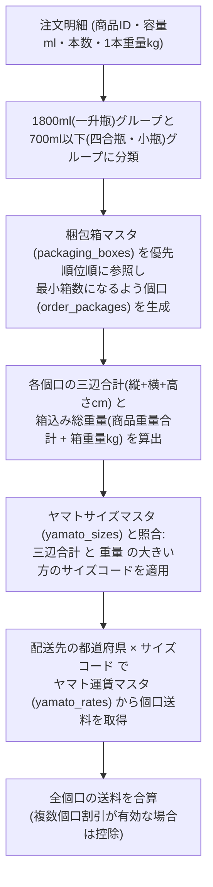

# 配送・梱包設計書

作成日: 2026-10-19  
版: 2.0（TypeScript + Hono + Cloudflare D1 対応版）

## 1. 目的

法人取引先が選択した「配送先」と「注文商品・数量」に基づき、以下を自動判定・計算するロジックを定義する。

1. **配送方式の判定**（近隣自社配達 または ヤマト宅急便）
2. **選択可能な「到着希望日」の算出**（リードタイム × 配送ルール期間 × 配送カレンダー）
3. **自動梱包計算・複数個口割り当て**（瓶容量・本数・重量に基づく箱選び）
4. **ヤマトサイズ判定および地域別運賃の算出**

---

## 2. 配送先と配送ルール設計

### 2.1 複数配送先対応
- 1つの取引先（`companies`）に対して複数の配送先（`shipping_addresses`：本店、支店、倉庫、系列店舗など）を登録可能とする。
- 各配送先には、小島醸造の管理者が事前に該当する `shipping_rule_id`（配送ルール）を設定する。

### 2.2 初期配送ルール定義（3区分）

| 配送ルールID | ルール名 | 対象地域・条件 | 配送方法 | 到着希望日 選択可能期間 | 配送料 |
|---|---|---|---|---|---|
| `RULE_AREA_A` | **指定地域配達** | 犬山市、小牧市、丹羽郡、江南市、各務原市、可児市 | 自社配達 | 毎月 **1日〜7日** および **15日〜22日** | **0円（無料）** |
| `RULE_AREA_B` | **45km圏内配達** | 上記以外で小島醸造からGoogle Mapsで45km以内の地域 | 自社配達 | 毎月 **1日〜7日** | **0円（無料）** |
| `RULE_YAMATO` | **ヤマト宅急便** | 上記以外の全国地域（配送会社：ヤマト運輸固定） | ヤマト宅急便 | 通月（営業日カレンダー準拠） | **梱包・サイズ・地域別運賃** |

---

## 3. 到着希望日と変更・キャンセル期限の算出ロジック

### 3.1 営業日の定義
- `delivery_calendar`（配送カレンダーマスタ）において `is_deliverable = 1`（配送可能）となっている日を「営業日（稼働日）」としてカウントする。
- 管理者は管理画面（`A-12`）から定休日・イベント出店・年末年始等の休業日を `is_deliverable = 0` に設定できる。

### 3.2 新規注文時に選択可能な「到着希望日」
顧客がカレンダー（`L-06`）を開いた際、以下の**3条件をすべて満たす日付のみ**を選択可能として返却する。

1. **最短リードタイム条件**: 注文当日から `settings.min_lead_business_days`（初期値：4営業日）以降の日付であること。
2. **配送ルール期間条件**: 選択中の配送先の配送ルール（例：`RULE_AREA_A` なら1〜7日または15〜22日）に含まれる日付であること。
3. **配送カレンダー条件**: `delivery_calendar` で配送不可（`is_deliverable = 0`）に設定されていないこと。

### 3.3 注文変更・キャンセル期限の算出
- 期限日時：**到着希望日の `cancel_business_days`（初期値：3）営業日前の `cancel_cutoff_time`（初期値：17:00）まで**
- 例：到着希望日が `10月2日(金)` で、間の水・木・金がすべて営業日の場合、`9月29日(火) 17:00` が変更・キャンセル期限となる。

---

## 4. 自動梱包・ヤマト送料計算アルゴリズム

配送先の配送方法が「ヤマト宅急便（`RULE_YAMATO`）」の場合、以下の手順で個口と配送料を算出する。

### 4.1 梱包割り当てルール詳細
1. **容量グループ別の箱詰め**:
   - **1800ml（一升瓶）**: 一升瓶専用箱（例：1本箱、2本箱、6本箱）へ優先的に割り当てる。たとえば8本注文時は「6本箱×1個口 ＋ 2本箱×1個口」の計2個口とする。
   - **700ml / 500ml / 300ml（ガラス瓶）**: `allow_mixed = 1`（混載可）の箱マスタ（例：6本箱、12本箱）へ、本数上限および重量上限を超えないように割り当てる。
2. **ヤマトサイズ判定**:
   - 各個口について、`三辺合計 = length_cm + width_cm + height_cm` と `総重量 = Σ(商品1本重量 × 箱内本数) + box_weight_kg` を計算する。
   - `yamato_sizes` テーブル（60サイズ：60cm/2kg、80サイズ：80cm/5kg、100サイズ：100cm/10kg、120サイズ：120cm/15kg、140サイズ：140cm/20kg、160サイズ：160cm/25kg）を参照し、三辺合計と総重量の両方が収まる最小の `size_code` を決定する。
3. **管理者による手動調整**:
   - 管理画面の注文編集（`A-04`）では、自動計算された個口内容や送料を管理者が手動で上書き変更（`is_shipping_fee_manual = 1`）できる仕組みを備え、特例的な同梱や送料調整にも柔軟に対応する。
